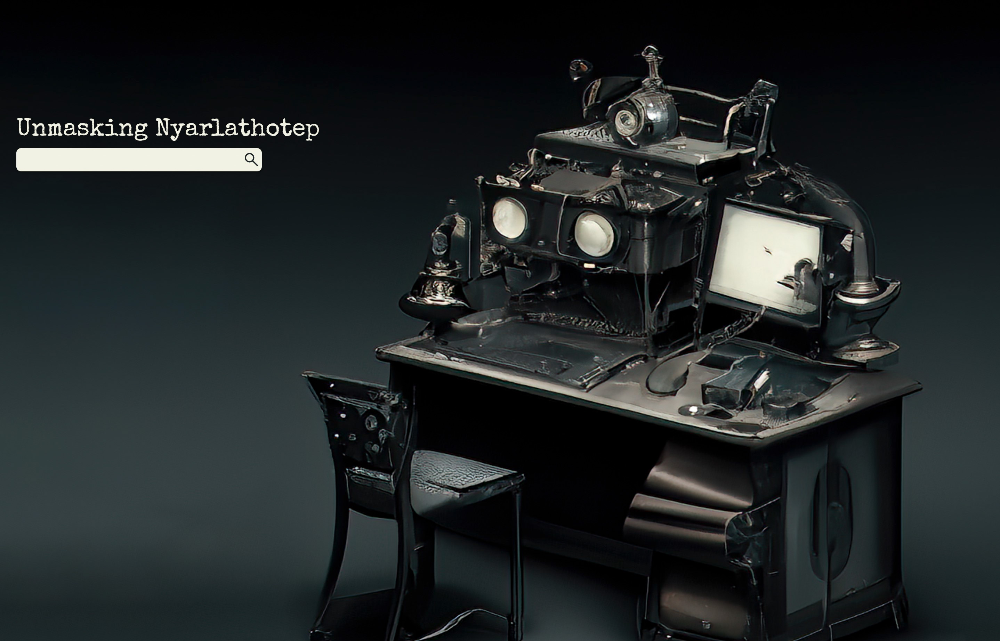
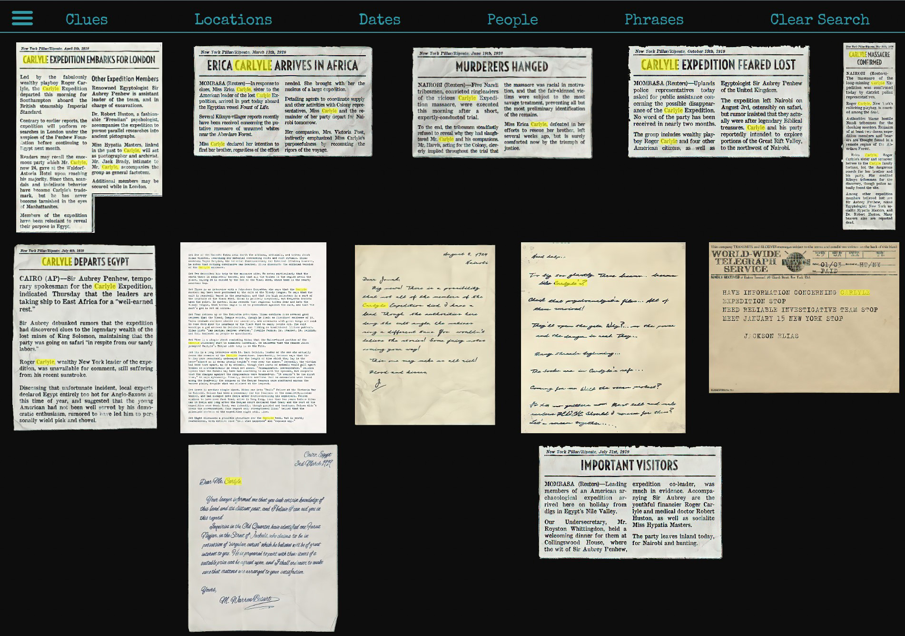
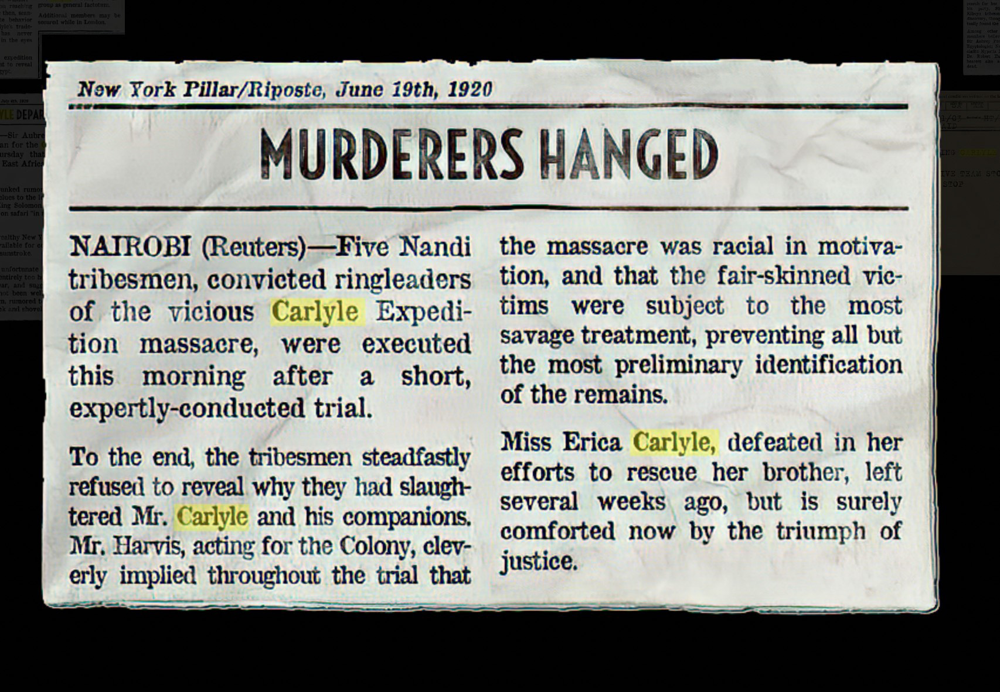
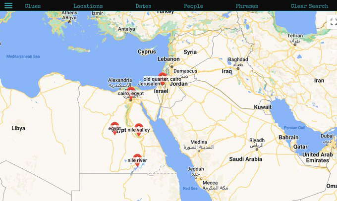
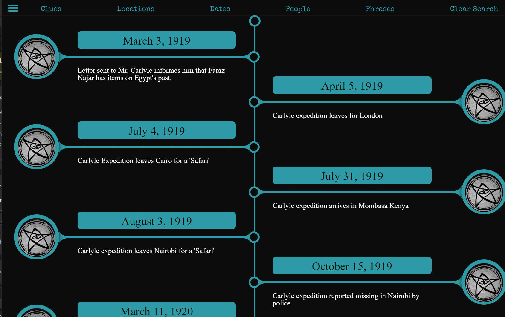
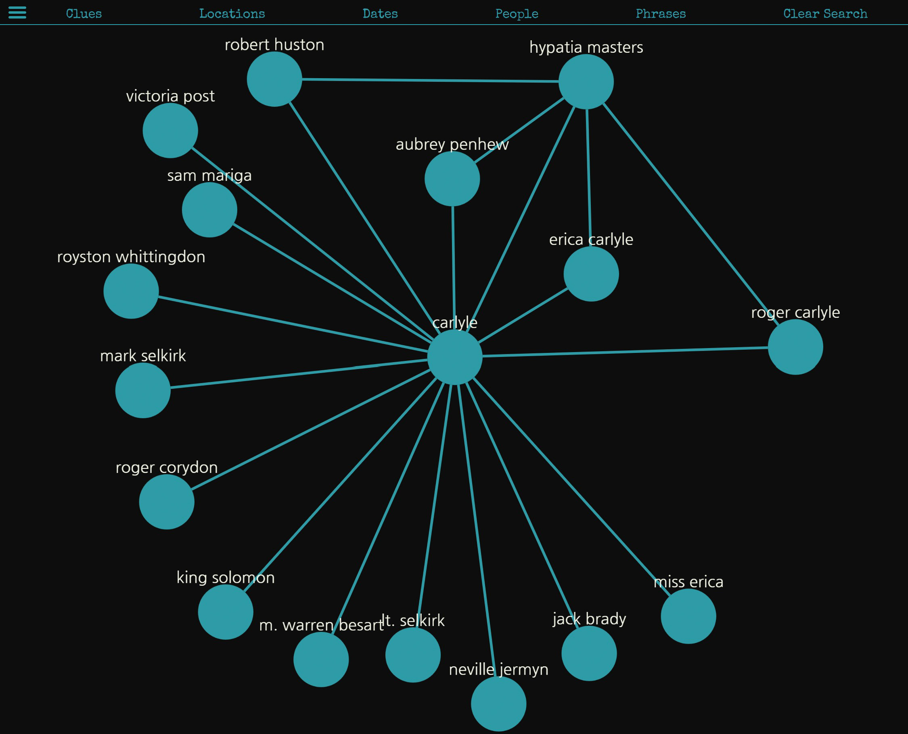

My friend and extraordinary GM, Jason Beaumont is running Call of Cthulhu's Masks of Nyarlathotep for me and our friends!   This is a huge, world-spanning campaign and Jason sprung for the immersive physical handouts.  In order to help the party keep track of all the clues, I built a web app on top of Azure Cognitive Search that processes photographs of all the clues and makes all the text searchable.  The app is called Unmasking Nyarlathotep.

From here you can enter a term (like 'Carlyle') and it will bring up all the clues that contain the text (with highlighting of the term!).

If you click on a clue, it zooms in so you can read the details of the clue.

The map page shows you any locations mentioned in your currently selected clues.

The timeline page takes any dates referenced and puts them in chronological order.

The people page shows you how people mentioned in the clues are connected.  A connection means they are both referenced in at least one clue together.

