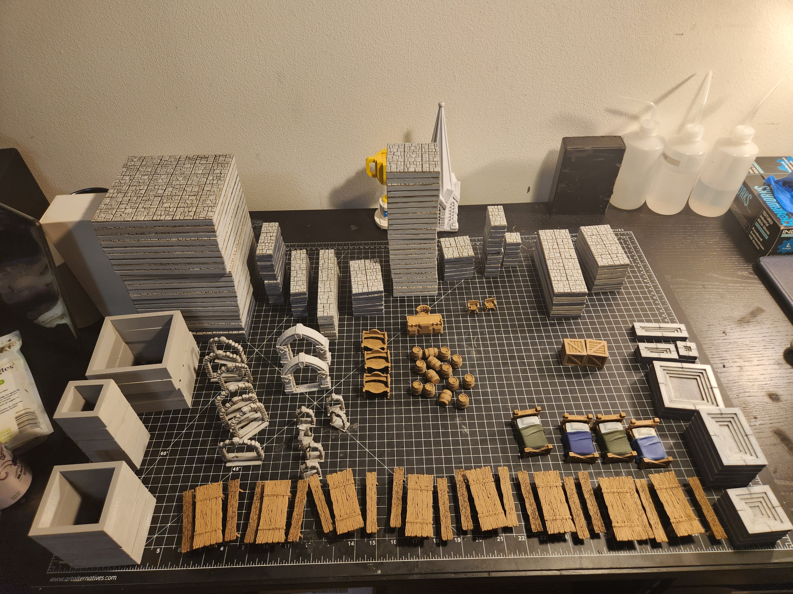
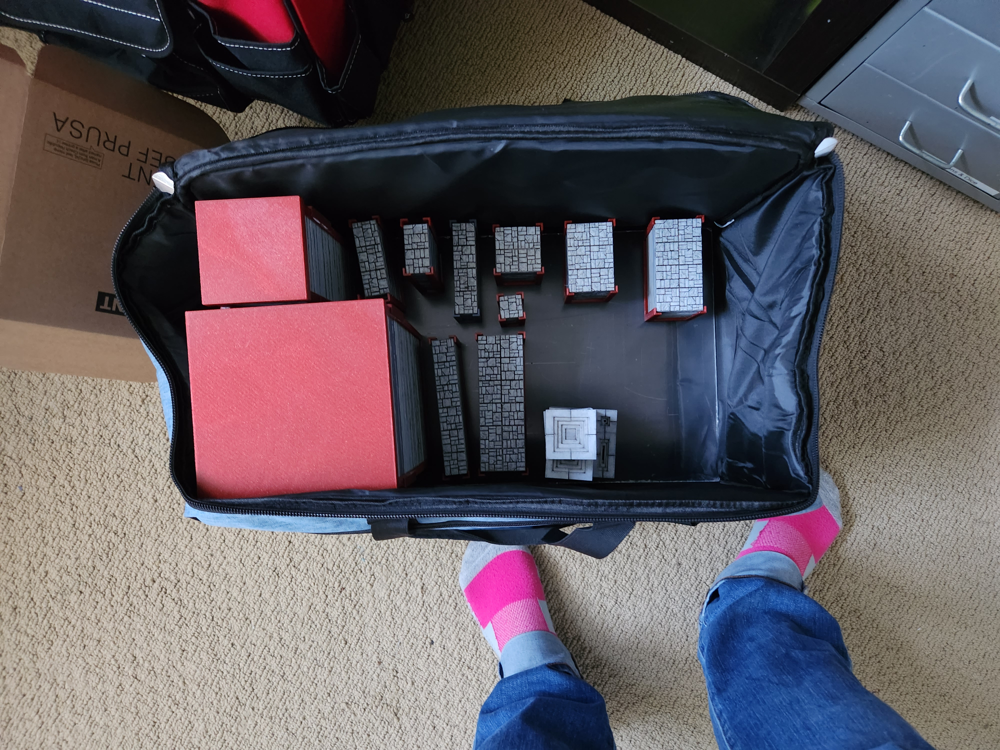

After many false starts and hours upon hours of 3D printing, I have finally finished my first set of 3D printed dungeon tiles.

I used Amolen's marble-like PLA filament, and each tile has magnets underneath so the tiles stick together as you layout your floorplan.

I also put together a carrying case out of an old board game bag.

